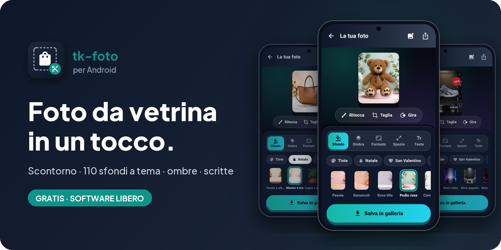
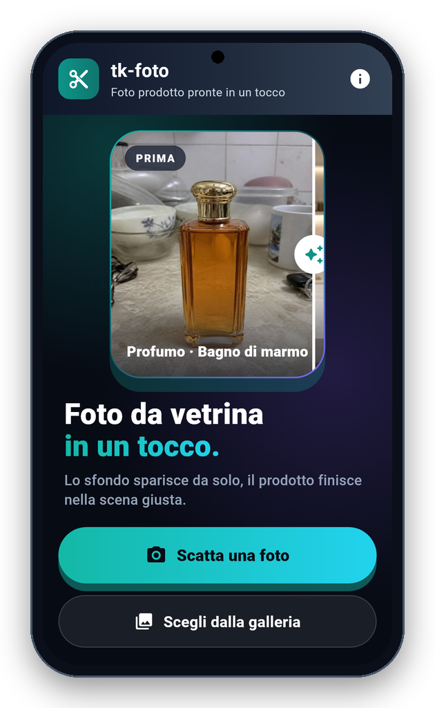
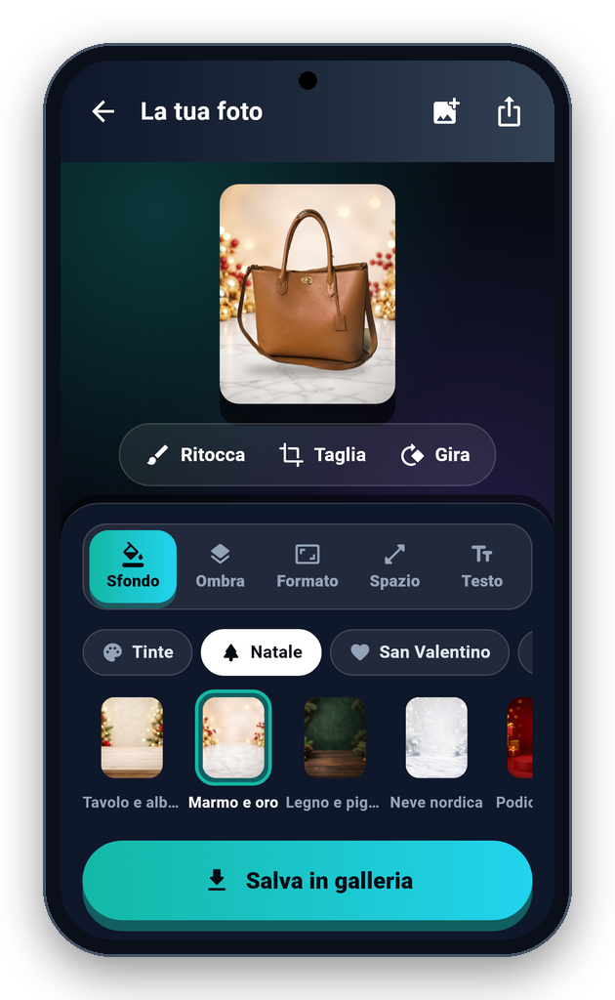
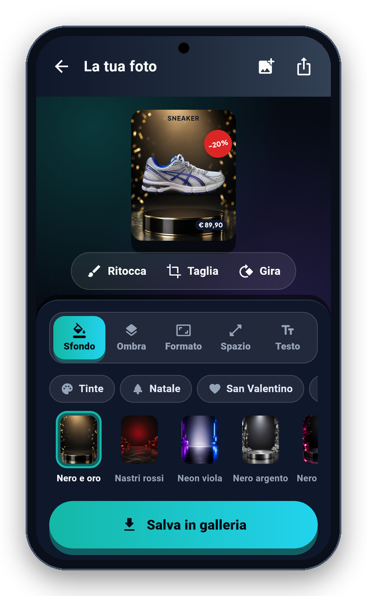
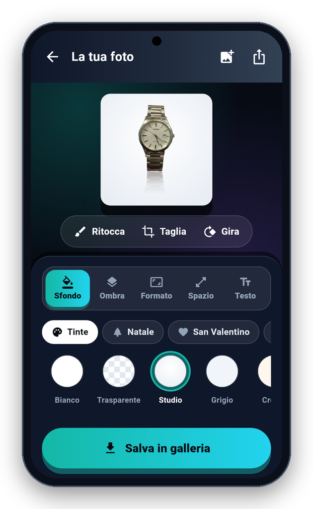
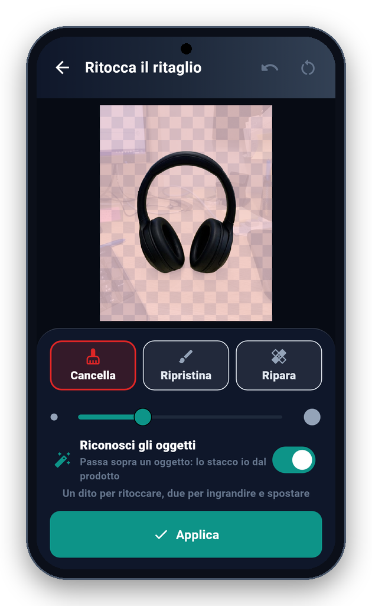
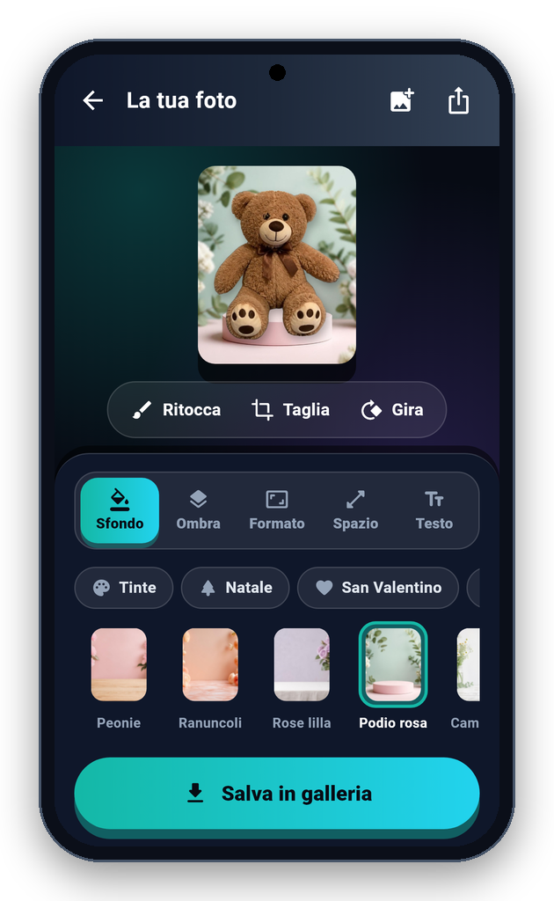

<!-- README generato da Dropbox/CLAUDE/dev/agpl-rollout/readme/genera_readme_app.py: modificare lì -->
<div align="center">



<br><br>

<a href="https://play.google.com/store/apps/details?id=it.pietrodefilippis.tkfoto"></a> &nbsp; <a href="https://pietrodefilippis.it/donazione/"></a>

<br><br>

<a href="COPYING"></a>   

</div>

---

## ✨ Cosa fa

<table>
<tr>
<td width="50%" valign="top">

### ✂️&nbsp; Scontorno sul telefono
Riconosce il prodotto e toglie lo sfondo, senza caricare la foto da nessuna parte.

</td>
<td width="50%" valign="top">

### 🎨&nbsp; 110 sfondi a tema
Tinte unite, sfumature e sfondi per Natale, San Valentino, Pasqua, saldi, Black Friday e altri.

</td>
</tr>
<tr>
<td width="50%" valign="top">

### 🌗&nbsp; Ombre e formati
Ombra morbida, a terra o riflesso; quadrato, verticale per le storie oppure orizzontale.

</td>
<td width="50%" valign="top">

### 🖌️&nbsp; Ritocco
Pennello con lente, «Riconosci gli oggetti» per togliere ganci e supporti, «Ripara» per ricostruire le parti nascoste.

</td>
</tr>
<tr>
<td width="50%" valign="top">

### 🏷️&nbsp; Scritte
Titolo, prezzo su etichetta, bollino di sconto e scritte libere, nei colori che vuoi.

</td>
<td width="50%" valign="top">

### 📤&nbsp; Pronta da usare
Salvi in galleria o condividi: per il negozio online, i social o un annuncio.

</td>
</tr>
</table>

## 📱 Com'è fatta

<div align="center">

<table align="center">
<tr>
<td align="center" valign="top"><br><sub><b>Home</b></sub></td>
<td align="center" valign="top"><br><sub><b>Sfondo a tema</b></sub></td>
<td align="center" valign="top"><br><sub><b>Scritte</b></sub></td>
</tr>
<tr>
<td align="center" valign="top"><br><sub><b>Studio</b></sub></td>
<td align="center" valign="top"><br><sub><b>Ritocco</b></sub></td>
<td align="center" valign="top"><br><sub><b>Festa</b></sub></td>
</tr>
</table>

</div>

## 🔒 I tuoi dati

- **Scontorno:** sul telefono. Su Android con il modello IS-Net (DIS, Apache 2.0), che l'app scarica una volta sola al primo avvio (46 MB); finché non c'è, con Google ML Kit. Su iPhone con Apple Vision.
- **Privacy:** foto e ritagli restano sul telefono, non vengono caricati da nessuna parte. Le statistiche anonime (una volta al giorno: nome, versione, sistema e un codice casuale) partono solo se dici sì nel benvenuto o in Informazioni.
- **Permesso aggiuntivo per le librerie:** Google ML Kit Subject Segmentation e Google Play services, vedi [ECCEZIONE-LICENZA.md](ECCEZIONE-LICENZA.md) (AGPL sez. 7).

Nessuna pubblicità, nessun account da creare, nessun abbonamento: tutte le funzioni sono gratis, per tutti.

## 📥 Installazione

- **Android** — da [Google Play](https://play.google.com/store/apps/details?id=it.pietrodefilippis.tkfoto): si installa e si aggiorna come ogni altra app.
- **Piattaforme:** Android e iPhone.

<details>
<summary><b>🛠️ Compilare dal codice sorgente</b></summary>

<br>

Serve [Flutter](https://flutter.dev) (versione indicata in `.github/workflows/android.yml`):

```bash
flutter pub get
flutter test
flutter build apk --release --target-platform android-arm,android-arm64
```

Senza la variabile `ANDROID_KEYSTORE` l'APK si firma con la chiave di debug di Flutter.

Gli sfondi a tema (`assets/sfondi/`) e le foto della vetrina (`assets/demo/`) non sono nel repo: sono contenuti grafici con una licenza propria, non coperti dall'AGPL, e stanno solo nell'app pubblicata. Compilando dal sorgente l'app funziona per intero (scontorno, sfondi a colori e sfumati, scritte, formati), senza quelle foto; le prove che le usano si saltano. Puoi mettere le tue foto in `assets/sfondi/<categoria>/01.jpg`, `02.jpg`…

</details>

## 📜 Licenza

**tk-foto** è software libero: © 2026 Pietro De Filippis (TecnikGeek), licenza
**[GNU Affero General Public License v3.0](COPYING)**. Puoi usarlo, studiarlo, modificarlo e condividerlo; è
fornito **così com'è, senza alcuna garanzia**.

> Il nome **tk-foto** e il logo non sono coperti dalla licenza (AGPL, sezione 7): una versione modificata deve avere un nome diverso.

---

<div align="center">

**Ti è utile?** Tutte le funzioni sono gratis per tutti. Se vuoi, un caffè aiuta a migliorarla e a crearne altre.

<a href="https://pietrodefilippis.it/donazione/"></a>

<sub>Creata da <a href="https://pietrodefilippis.it">Pietro De Filippis · TecnikGeek</a> — Webmaster & UX/UI Designer</sub>

</div>
